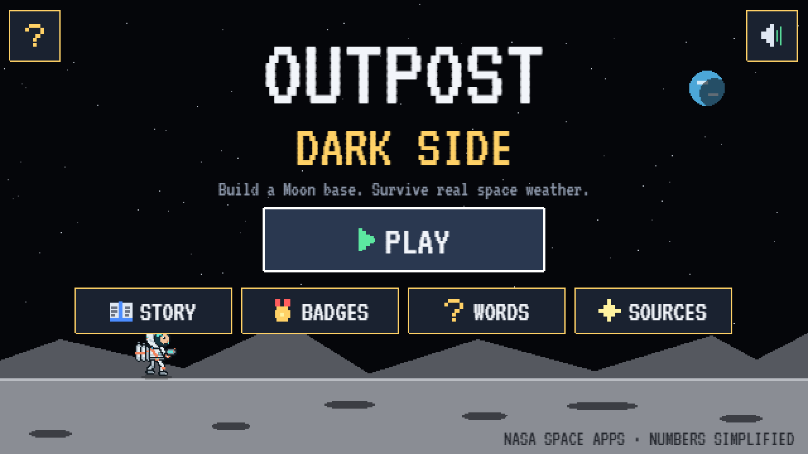
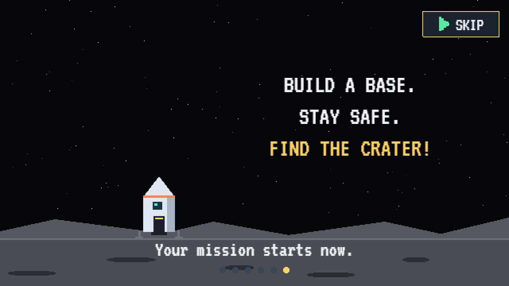
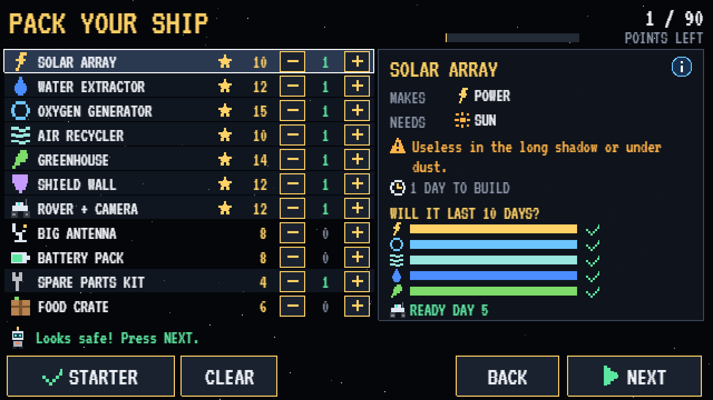
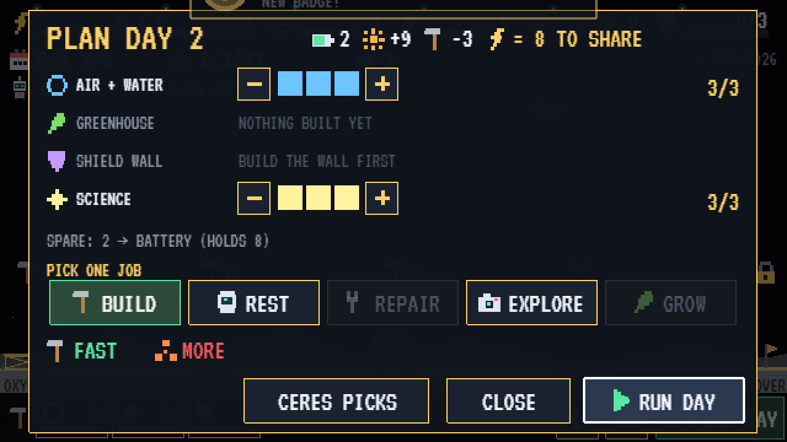
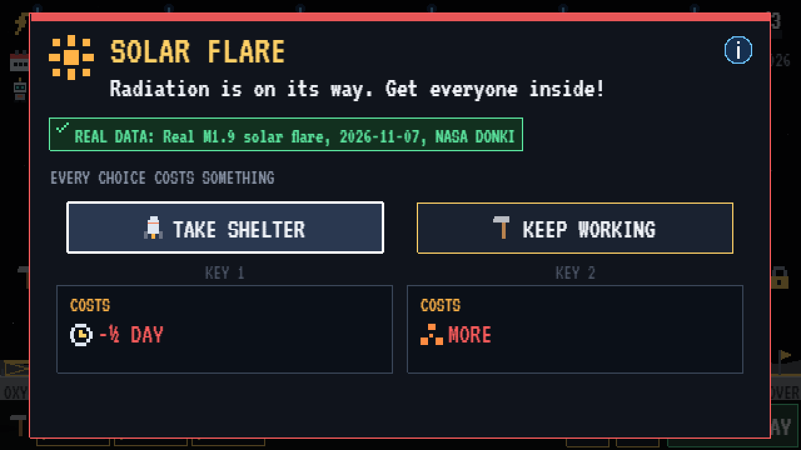
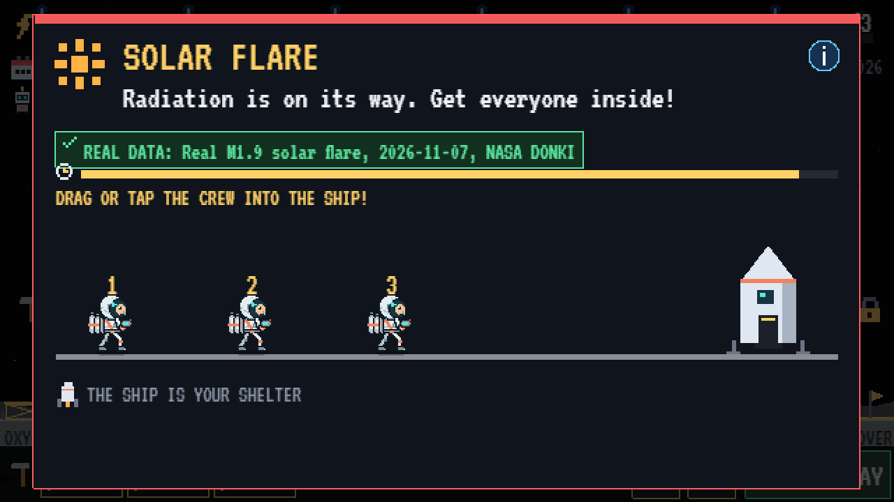
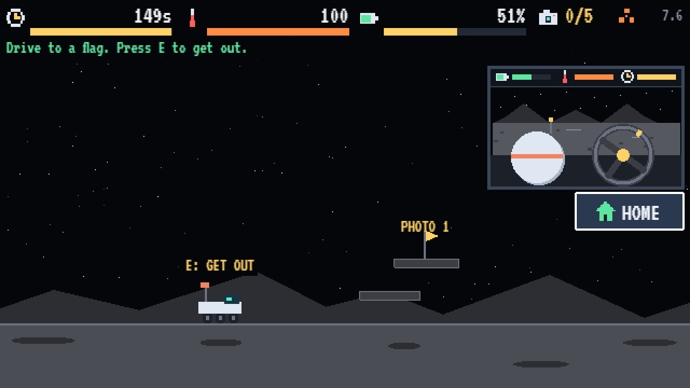
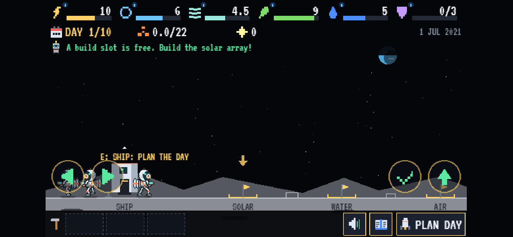

# OUTPOST: Dark Side

A browser game for ages 7–12 about running a Moon base on real NASA space-weather data.

**Play it:** [fill in here: public link]



---

## 1. Project Overview

| | |
| --- | --- |
| **Project name** | OUTPOST: Dark Side |
| **Team** | [fill in here: team name and members] |
| **NASA challenge** | [fill in here: exact challenge title, NASA Space Apps Challenge 2026] |
| **Event / location** | [fill in here] |

**One-sentence solution:** A single-player pixel game where a child builds six life-support buildings on the Moon, survives solar storms taken from NASA's real records, and learns that every choice saves one thing and costs another.

---

## 2. Problem & Impact

**The problem.** A lunar outpost only works if power, oxygen, clean air, water, food and radiation shielding are balanced against each other, and they all compete for the same limited power, time and cargo. That kind of trade-off thinking is hard to teach from a textbook. Games on the topic tend to be either too simple (one meter to watch) or too complicated (a full engineering simulator).

**Who it affects.** Children aged 7–12, and the teachers, parents and outreach staff who want to explain how people could live on the Moon.

**Why it matters.** Artemis-era missions depend on a public, and a future workforce, that understands why living off Earth is difficult. Real mission data is public, but very little of it is presented in a form a child can use.

**Expected impact.** After one 10–15 minute mission, a player should be able to explain in their own words:

- why clean air runs out before anything else;
- why an oxygen generator is useless without water;
- why hiding from a solar flare is worth losing work time;
- why engineers plan for the worst day, not the average day.

[fill in here: any target numbers, schools, or partners you plan to reach]

---

## 3. Proposed Solution

### How it works

1. **Choose a mission.** **Real Science** replays a real date from NASA's records (Calm Sun, Busy Sun, Solar Storm!, This Month) at Easy, Medium or Hard. **Custom** lets the player pick the Sun, the hazards, the days and the number of alerts.
2. **Briefing.** The goal and the three tasks, shown as pictures.
3. **Pack.** Spend a budget of Mission Points on blueprints and kits. Anything not packed cannot be built. "Will it last?" bars show the first day each supply would run out.
4. **Land, then build.** Walk and jump around the base as an astronaut. Only three things can be built at once. Each day, split the power between life support, greenhouse, shield wall and science, pick one action, and run the day.
5. **React.** Weather alerts interrupt the day. Each has a hands-on mini-game and at least two choices, and every choice has a visible cost.
6. **Explore.** Once all six buildings and the rover stand, drive to the far side and photograph five craters before the cold and the clock run out. Each photo reveals a real NASA image of that place.
7. **Debrief.** See what happened and why, as a cause-and-effect chain, with the real science behind it.

### Key features

- **Six resources, six buildings:** power, oxygen, clean air, food, water, radiation shielding.
- **Eight alerts:** solar flare, long shadow, micrometeorite, air leak, sticky moon dust, cold snap, sick plants, and a delayed radio call to Earth.
- **No free choice:** an automated test fails the build if any alert option has zero cost.
- **A robot guide (Ceres)** shows one sentence about what matters most right now, and the related meter pulses.
- **Kind failure:** nobody dies. The crew is "evacuated to the ISS" and the debrief explains the chain of events and how to do better.
- **Replayable:** a different date or weather deck gives a different mission.
- **Less reading, more pictures:** every on-screen message is 12 words or fewer (checked by a test); supplies, costs and results are shown as icons.
- **"Did you know?" cards:** a round "i" on meters, buildings, alerts and photos opens a picture card with 1–3 short lines. Never forced.
- **Glossary:** 82 terms with search and A–Z, covering all 67 NASA Space Place topics plus Moon-base words. Definitions are our own words, with a link back to Space Place.
- **Opening story and landing:** a 33-second animated story on first launch (replayable), and an animated touchdown.
- **Tutorials and hints:** step-by-step coach marks that point at the real button, plus one-at-a-time tips from Ceres.
- **Badges and pop-ups:** 16 badges, and a medal pop-up when a building is finished or a badge is earned.
- **Sound:** effects, a rover engine hum and quiet music, all generated in the browser. Mute and volume settings are saved.
- **Phones and tablets:** on-screen buttons for touch, landscape play, and a "turn your phone" screen in portrait.
- **Rover cockpit:** while driving, a window shows the view from behind the helmet with a steering wheel that turns as you steer.
- **Accessible:** fully playable by keyboard or by mouse, icons use shape as well as colour, and every science word has a one-sentence explanation.

### What makes it different

- **The difficulty is real.** The "Solar Storm!" mission replays the May 2024 Gannon storm day by day. A calm mission uses a week from solar minimum.
- **Honest labelling.** Real data carries a green "REAL DATA" badge with its source and date. Everything scaled for play is labelled "simplified". Saved data is never called "live".
- **Cause and effect over score.** The debrief shows *why* the mission ended the way it did, not only a number.

---

## 4. NASA Data & Technical Approach

### Datasets used and why

| Data | Source | How it is used in the game |
| --- | --- | --- |
| Solar flares, particle storms, solar clouds (CMEs), geomagnetic storms | [NASA DONKI](https://ccmc.gsfc.nasa.gov/tools/DONKI/) | Each mission day's solar alert, its size, the difficulty stars, and the "what really happened that week" list in the debrief |
| Far-side lunar photos (LRO and Artemis II) | [NASA Image and Video Library](https://images.nasa.gov/) | The real photo revealed after each crater picture, with credit |
| Space biology studies | [NASA OSDR](https://osdr.nasa.gov/bio/repo/) | The science fact card in the debrief, matched to how the mission was played |
| Radiation limits: 600 mSv career, 250 mSv for one particle storm | [NASA-STD-3001 radiation brief](https://www.nasa.gov/wp-content/uploads/2023/03/radiation-protection-technical-brief-ochmo.pdf) | Dose comparisons in the debrief |
| Chest X-ray ≈ 0.1 mSv | [NASA NTRS](https://ntrs.nasa.gov/api/citations/20250006168/downloads/ASCEND%20Simonsen%20draft%201.pdf) | "That is about N chest X-rays" |
| May 2024 Gannon storm reference | [NASA Science](https://science.nasa.gov/science-research/heliophysics/how-nasa-tracked-the-most-intense-solar-storm-in-decades/) | The "Solar Storm!" preset |

**Non-NASA sources, credited in-game:**

- Moon surface dose of about 1.37 mSv per day: Chang'e-4 lander, [Zhang et al. 2020, *Science Advances*](https://doi.org/10.1126/sciadv.aaz1334).
- Greenhouse rules: [Canadian Space Agency food production toolkit](https://www.asc-csa.gc.ca/eng/youth-educators/toolkits/food-production/).

### The five cached date windows

| Preset | Dates | X flares | M flares | Particle storm records | Earth-directed clouds |
| --- | --- | --- | --- | --- | --- |
| Calm Sun | 1–11 Dec 2019 | 0 | 0 | 0 | 0 |
| Busy Sun | 1–11 Jul 2021 | 1 | 3 | 1 | 1 |
| Solar Storm! | 8–18 May 2024 | 14 | 85 | 14 | 15 |
| This month | 15 Oct – 14 Nov 2026 | 0 | 10 | 0 | 3 |
| Random date | all of 2023 | 13 | 369 | 75 | 137 |

### How real data becomes gameplay

- Each mission day gets at most one solar alert: the strongest event recorded on that calendar date.
- Dose added per event (game scale, simplified): M flare 0.2 mSv, X flare 1.0 mSv, particle storm 3.0 mSv.
- Difficulty score = 1 × M days + 3 × X days + 5 × particle-storm days + 2 × Earth-directed cloud days. One star for 0–2, two for 3–15, three for 16 or more.

### System architecture

```
scripts/fetch-nasa.js  ──►  public/data/*.json, public/assets/craters/*.jpg
   (run once, at build time)        (cached copies with fetch dates)
                                              │
                                              ▼
src/data/      loaders for the cached files
src/sim/       pure game rules (no Phaser): state, rules, buildings,
               events, difficulty, scoring  ──► tested with Vitest
src/scenes/    Phaser scenes: Title, Blueprints, WeatherDeck, DateSelect,
               Landing, Outpost (+ OutpostUi), Alert, RoverBuild,
               PhotoMission, Evacuated, Debrief, Credits
src/minigames/ DragToShelter, PatchLeak, DustWipe, RepairBot,
               Controls (switches and sliders), Viewfinder
src/ui/        meters, sliders, toggles, build queue, alert card,
               tooltips, data badges, sound
```

- **Stack:** JavaScript (ES modules), Phaser 4, Vite, Vitest. 640×360 pixel-art canvas scaled to fit.
- **No API key in the browser and no calls to NASA while playing.** All data is fetched once by a Node script and shipped as static files, so the game works offline.
- **Static build**, hostable on any static host. No login, no backend.

### Run it locally

```
npm install
npm run dev          # play at the address Vite prints
npm test             # rules-engine tests
npm run build        # production build in dist/
npm run fetch-nasa   # refresh the cached NASA data (needs internet)
```

Controls: arrow keys or A/D to walk, Up/W/Space to jump, E to use, P for the day plan, G for the glossary. Mouse works everywhere. On a touch screen, tap the ground or a building to walk there, or use the on-screen arrows, JUMP and USE buttons.

---

## 5. Prototype & Demonstration

**Working prototype:** [fill in here: public link]
**Demo video:** [fill in here]
**Slides:** [fill in here]

| | |
| --- | --- |
|  **Opening story:** six animated scenes, one line each |  **Choose a mission:** real dates, stars from NASA records, Easy/Medium/Hard |
|  **Pack the ship** with a point budget and "Will it last?" bars |  **Tutorials** point at the real thing to tap, one step at a time |
|  **The base:** icon meters, Ceres's tip, build slots, and a badge pop-up |  **Daily plan:** share the power, pick one job |
|  **A real solar flare** with its data badge and the cost of each choice as icons |  **Mini-game:** get the crew into shelter before the timer ends |
|  **"Did you know?"** cards open only from an "i" button |  **Glossary:** search, A–Z, our own definitions, NASA Space Place topics |
|  **Rover cockpit:** the wheel turns as you steer |  **Photo race:** the real NASA image of the place |
|  **On a phone:** on-screen arrows, JUMP and USE |  **Debrief:** stars, score, and why it went that way |

---

## 6. Validation & Limitations

### What was tested

- **Rules engine:** 56 automated tests pass. They cover the three-build limit, the rover lock, the "no free choice" rule, the greenhouse delay, the difficulty ratings of the preset dates, balance checks (every Real Science scenario can be won at every difficulty; the storm date only by mixing shelter and work), the 12-word limit on every message, the glossary links, and every badge.
- **Automated play-throughs** in a headless browser with real key presses and mouse drags, with no runtime errors:
  - the full base phase on Busy Sun and Solar Storm with every weather card;
  - all three photo-race endings (five photos, heading home early, running out of time);
  - an evacuation from building nothing;
  - all eight alerts, by keyboard and by mouse;
  - touch-only play on emulated phones and a tablet (844×390, 667×375, 1024×768), with 49–60 fps at 4× CPU slowdown.
- **Facts checked against sources:** radiation limits, the chest X-ray comparison, the Moon dose rate, and the Gannon storm dates. Each of the five crater photos was viewed before it was added.

### Limitations

- **All game numbers are simplified.** Supply amounts, power, build times and event doses are scaled so a mission lasts minutes. The game says so on screen.
- **Data is cached, not live.** "This month" shows the 30 days before the cache date.
- **The photo race is side-view only**, and its crater photos are the only real imagery in the game.
- **Eight fact topics** are included; two of them (sleep, moon dust) have no linked OSDR study.
- English only. Moon only. Music and sound are simple generated tones.
- The NASA `api.nasa.gov` DONKI flare endpoint returned an error when the data was fetched, so the script reads the same records directly from CCMC, the NASA centre that runs DONKI.

### What remains unverified

- **No child has played it yet.** Whether a 7-year-old can finish without help, and whether the 150-second photo race is fair, is untested.
- **Real phones and tablets** have not been tested, only emulated ones. On the smallest phones some 36 px buttons show at about 38 css px, a little under the 44 px target.
- **Learning outcomes** in section 2 are goals, not measured results.
- **Screen readers** are not supported; the game is drawn on a canvas.
- [fill in here: any playtest results or feedback you collect]

---

## 7. Impact & Future Development

### Expected benefits

- Children practise weighing one need against another, using the same hazards real mission planners face.
- Real space-weather records become something a child can feel: the May 2024 storm is a hard week to survive.
- Every source is cited in the game, so a curious player or teacher can follow it back to NASA.

### Potential users

- Children aged 7–12 at home.
- Primary and lower-secondary teachers, as a 15-minute classroom activity.
- Science centres, libraries and space outreach events.
- [fill in here: any specific partners or audiences]

### Next steps

1. Playtest with children in the target age range and tune the numbers and wording.
2. Test and adjust for touch screens.
3. Classroom mode: the teacher picks one date and the class compares results.
4. Live "this month" mode through a small proxy that hides the API key.
5. ISS and Mars scenarios, using ISS dosimetry and Mars surface data.
6. More languages and a larger set of fact cards.
7. [fill in here: your team's own priorities]

### Closing

Living on the Moon is not one big problem. It is a hundred small trade-offs made every day, with the Sun deciding how hard each day will be. OUTPOST: Dark Side lets a child make those trade-offs with real data, fail safely, see why, and try again.

---

## Credits

- Space weather: NASA DONKI, Community Coordinated Modeling Center.
- Crater images: NASA/GSFC/Arizona State University (Lunar Reconnaissance Orbiter) and NASA (Artemis II).
- Studies: NASA Open Science Data Repository.
- Font: VT323 by Peter Hull (SIL Open Font License), bundled locally.
- Glossary topics: NASA Space Place (spaceplace.nasa.gov/glossary). Definitions written for this game.
- Team: [fill in here]
- License: [fill in here]

NASA does not endorse this project. All game numbers are simplified and are not mission data.
